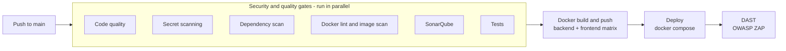

# DevBoard — DevSecOps Pipeline & Containerization

A full-stack task board (**React + Go + PostgreSQL**) with a complete **DevSecOps layer** built around it: hardened multi-stage Docker images and a 14-workflow GitHub Actions pipeline that tests, scans, builds, publishes and deploys the app on every push to `main`.

> **About this repository**
> The application code (frontend, backend, database schema) comes from the original DevBoard project.
> **The DevOps layer is my work:** `backend/Dockerfile`, `frontend/Dockerfile` and everything in `.github/workflows/`.

---

## 🧭 Table of Contents

- [My DevOps Contribution](#-my-devops-contribution)
- [CI/CD Pipeline Architecture](#-cicd-pipeline-architecture)
- [Pipeline Stages in Detail](#-pipeline-stages-in-detail)
- [Containerization](#-containerization)
- [Workflow Reference](#-workflow-reference)
- [Secrets & Variables Setup](#-secrets--variables-setup)
- [SonarQube Setup on EC2](#-sonarqube-setup-on-ec2)
- [Run the Application Locally](#-run-the-application-locally)
- [Application Overview](#-application-overview)
- [Project Structure](#-project-structure)
- [Tech Stack](#-tech-stack)

---

## 🛠️ My DevOps Contribution

| Area | Path | What I built |
|------|------|--------------|
| CI/CD & security automation | `.github/workflows/` | 14 GitHub Actions workflows: an end-to-end DevSecOps pipeline made of reusable workflows, plus standalone CI, CD and matrix-lint workflows |
| Backend containerization | `backend/Dockerfile` | Multi-stage build on a hardened Go image, static binary, non-root runtime |
| Frontend containerization | `frontend/Dockerfile` | Multi-stage build: Node builds the app, hardened nginx serves only the static output, non-root runtime |

**Highlights**

- 🔐 **Shift-left security:** SAST, secret scanning, dependency auditing, Dockerfile linting, image scanning and DAST are all part of the pipeline
- 🧩 **Reusable workflows:** every stage lives in its own `workflow_call` file and is orchestrated by one entry-point workflow
- 🚦 **Quality gate:** images are published only after *all* checks pass
- 🐳 **Hardened images:** multi-stage builds, minimal runtime, non-root users
- 🔁 **Matrix builds:** backend and frontend are scanned and published in parallel from a single job definition

---

## 🔄 CI/CD Pipeline Architecture

The main pipeline is [`devsecops-CI.yml`](.github/workflows/devsecops-CI.yml). It triggers on **every push to `main`**.



- **CI half:** the six gates run in parallel. `docker-push` declares `needs:` on all of them, so a single failure blocks publishing.
- **CD half:** deploy runs after the push; the DAST scan runs after deploy.

---

## 🔍 Pipeline Stages in Detail

| # | Stage | Workflow | Tools | What it checks |
|---|-------|----------|-------|----------------|
| 1 | Code quality (SAST) | [`code-quality.yml`](.github/workflows/code-quality.yml) | ESLint, `go fmt`, `go vet` | Lints the frontend, formats and vets the backend |
| 2 | Secret scanning | [`secret-scanning.yml`](.github/workflows/secret-scanning.yml) | Gitleaks | Scans the **full git history** (`fetch-depth: 0`) for leaked secrets |
| 3 | Dependency scan | [`dependency-scan.yml`](.github/workflows/dependency-scan.yml) | `govulncheck`, `npm audit` | Audits Go modules and production npm packages; report uploaded as an artifact (7-day retention) |
| 4 | Docker scan | [`docker-scan.yml`](.github/workflows/docker-scan.yml) | Hadolint, Trivy | Lints each Dockerfile, builds each image, then fails on **CRITICAL** OS/library vulnerabilities (unfixed ones ignored) |
| 5 | Code analysis | [`sonar-scan.yml`](.github/workflows/sonar-scan.yml) | SonarQube | Static analysis of the codebase |
| 6 | Tests | [`code-tests.yml`](.github/workflows/code-tests.yml) | `go test`, npm test | Backend and frontend unit tests |
| 7 | Build and publish | [`docker-push.yml`](.github/workflows/docker-push.yml) | Docker Buildx, Docker Hub | Matrix build (`backend`, `frontend`) pushed as `<user>/devboard-<service>:latest` |
| 8 | Deploy | [`deploy.yml`](.github/workflows/deploy.yml) | Docker Compose | `docker compose pull && docker compose up -d` |
| 9 | DAST | [`dast.yml`](.github/workflows/dast.yml) | OWASP ZAP | Baseline scan of the running app for OWASP Top 10 issues |

---

## 🐳 Containerization

### `backend/Dockerfile` — Go API

| Stage | Base image | Purpose |
|-------|-----------|---------|
| `builder` | `dhi.io/golang:1.26.11-alpine3.24-dev` | Downloads modules, compiles the binary |
| runtime | `dhi.io/golang:1.26.11-alpine3.24` | Runs only the compiled binary |

- **Layer caching:** `go.mod` / `go.sum` are copied and downloaded *before* the source, so dependencies are cached between builds
- **Small static binary:** `CGO_ENABLED=0`, `-trimpath`, and `-ldflags="-s -w"` (symbols stripped)
- **Non-root:** runs as UID/GID `65532`
- **Exposes** port `8080`, with an explicit `ENTRYPOINT`
- A `.dockerignore` keeps `.git`, markdown files, `node_modules` and `dist` out of the build context

### `frontend/Dockerfile` — React app

| Stage | Base image | Purpose |
|-------|-----------|---------|
| `build` | `dhi.io/node:26-alpine3.24-dev` | `npm ci`, then `npm run build` |
| `runtime` | `dhi.io/nginx:1.30.6-alpine3.24` | Serves only the generated static files |

- **Reproducible installs:** `npm ci` against the lockfile
- **Minimal runtime:** only `/app/dist` is copied into the nginx image — no Node, no source code
- **Non-root:** files owned by and run as the `nginx` user
- **Exposes** port `8080`

Both images are built on **Docker Hardened Images** (`dhi.io`) to reduce the attack surface, and every image is linted with Hadolint and scanned with Trivy in CI.

---

## 📚 Workflow Reference

All workflows live in [`.github/workflows/`](.github/workflows/).

| File | Trigger | Role |
|------|---------|------|
| `devsecops-CI.yml` | push to `main` | **Orchestrator** for the full pipeline |
| `code-quality.yml` | `workflow_call` | Linting and static checks |
| `secret-scanning.yml` | `workflow_call` | Gitleaks scan |
| `dependency-scan.yml` | `workflow_call` | `govulncheck` and `npm audit` |
| `docker-scan.yml` | `workflow_call` | Hadolint and Trivy (matrix: frontend, backend) |
| `sonar-scan.yml` | `workflow_call` | SonarQube scan |
| `code-tests.yml` | `workflow_call` | Go and frontend tests |
| `docker-push.yml` | `workflow_call` | Build and push images (matrix) |
| `deploy.yml` | `workflow_call` | Deploy with Docker Compose |
| `dast.yml` | `workflow_call` | OWASP ZAP baseline scan |
| `ci.yml` | manual (`workflow_dispatch`) | Standalone test, build and push for both services |
| `cd.yml` | manual (`workflow_dispatch`) | Standalone deploy on a **self-hosted** runner |
| `matrix.yml` | manual (`workflow_dispatch`) | Go lint across multiple Go versions (1.23, 1.24, 1.25) |

---

## 🔑 Secrets & Variables Setup

Go to **Repository → Settings → Secrets and variables → Actions** and add:

| Type | Name | Used for |
|------|------|----------|
| Variable | `DOCKERHUB_USERNAME` | Docker Hub login and image names |
| Secret | `DOCKERHUB_TOKEN` | Docker Hub Personal Access Token |
| Secret | `SONAR_TOKEN` | SonarQube authentication |
| Secret | `SONAR_HOST_URL` | SonarQube server URL (or `https://sonarcloud.io`) |

**Generating a SonarQube token:** SonarQube → **Profile → My Account → Security → Generate Tokens** → choose *User Token* → copy it into `SONAR_TOKEN`.

---

## ☁️ SonarQube Setup on EC2

To run a self-hosted SonarQube server:

1. With Docker installed on the EC2 instance, start the container:
   ```bash
   docker run -itd --name SonarQube-Server -p 9000:9000 sonarqube:community
   ```
2. Open port `9000` in the EC2 **Security Group** inbound rules.
3. Browse to `http://<YOUR_EC2_PUBLIC_IP>:9000` and log in with `admin` / `admin` (you'll be prompted to change the password).
4. Generate a token and add `SONAR_TOKEN` and `SONAR_HOST_URL` as shown above.

---

## 🚀 Run the Application Locally

**Requirements:** Docker with Docker Compose — nothing else (Node, Go and Postgres all run in containers).

```bash
cp .env.example .env      # one-time: create your settings file
docker compose up --build
```

Or use the Makefile shortcuts:

```bash
make           # list all commands
make up        # create .env if needed, then build and start everything
make down      # stop everything
make logs      # follow the logs
make ps        # show running containers
make reset     # wipe the database and start fresh
make smoke     # quick health check of backend, frontend and DB
```

| Service | Address | Notes |
|---------|---------|-------|
| Frontend | http://localhost:8080 | The app |
| Backend | http://localhost:8081/health | Go API health check |
| Postgres | `localhost:5432` | `devboard` / `devboard` (local demo defaults) |

All ports and credentials are configured in `.env` (template: `.env.example`). The real `.env` is git-ignored.

---

## 📦 Application Overview

```
browser → frontend (React) → backend (Go API) → database (Postgres)
```

- **frontend**: React app (Vite, Tailwind); requests to `/api` are forwarded to the backend
- **backend**: small Go service that reads and writes the database
- **database**: Postgres, seeded with example projects and tasks on first start (`init/postgres/`)

### API

| Method | Path | Description |
|--------|------|-------------|
| GET | `/projects` | List projects |
| POST | `/projects` | Create a project |
| GET | `/tasks?project_id=N` | List tasks in a project |
| POST | `/tasks` | Create a task |
| PATCH | `/tasks/:id` | Update a task (e.g. status) |
| GET | `/search?q=&project_id=N` | Search tasks by title |
| GET | `/health` | Health check |

---

## 📁 Project Structure

```
.
├── .github/workflows/        ⭐ CI/CD and security pipeline (14 workflows)
│   ├── devsecops-CI.yml        orchestrator, runs on push to main
│   ├── code-quality.yml        ESLint, go fmt, go vet
│   ├── secret-scanning.yml     Gitleaks
│   ├── dependency-scan.yml     govulncheck, npm audit
│   ├── docker-scan.yml         Hadolint, Trivy
│   ├── sonar-scan.yml          SonarQube
│   ├── code-tests.yml          Go and frontend tests
│   ├── docker-push.yml         build and push to Docker Hub
│   ├── deploy.yml              docker compose deploy
│   ├── dast.yml                OWASP ZAP
│   ├── ci.yml                  standalone CI (manual)
│   ├── cd.yml                  standalone CD (manual, self-hosted)
│   └── matrix.yml              multi-version Go lint (manual)
├── backend/
│   ├── Dockerfile            ⭐ multi-stage hardened Go image
│   ├── .dockerignore
│   ├── main.go · main_test.go · go.mod · go.sum
├── frontend/
│   ├── Dockerfile            ⭐ multi-stage Node build + hardened nginx
│   ├── .dockerignore
│   ├── src/ · public/ · package.json · vite.config.js · ...
├── init/postgres/            schema and seed data, loaded on first start
├── docker-compose.yml        frontend + backend + postgres
├── Makefile                  short commands (make up, make down, ...)
├── .env.example              settings template (copy to .env)
└── sonar-project.properties  SonarQube project config
```

⭐ = my work

---

## 🧰 Tech Stack

| Layer | Tools |
|-------|-------|
| Containers | Docker, Docker Hardened Images, multi-stage builds, Docker Compose |
| CI/CD | GitHub Actions, reusable workflows, matrix builds, self-hosted runner |
| Code and dependency security | ESLint, `go vet`, SonarQube, `govulncheck`, `npm audit` |
| Secrets, image and runtime security | Gitleaks, Hadolint, Trivy, OWASP ZAP |
| Registry | Docker Hub |
| Application | React, Vite, Tailwind CSS, Go, PostgreSQL |

## Author

**Vikash** — [@imVikash-ai](https://github.com/imVikash-ai)

---

*If this repo helped you, consider giving it a star.*